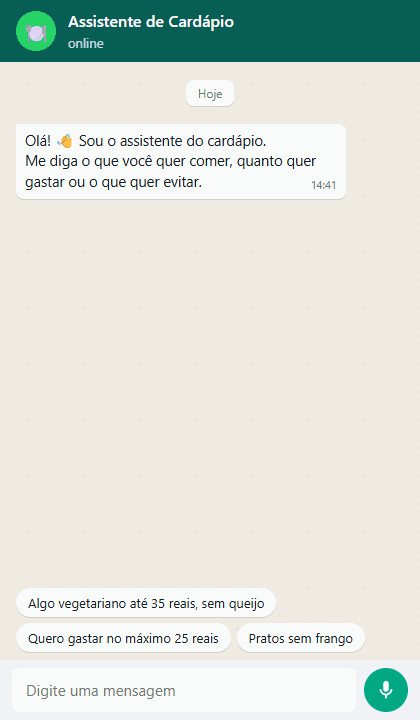
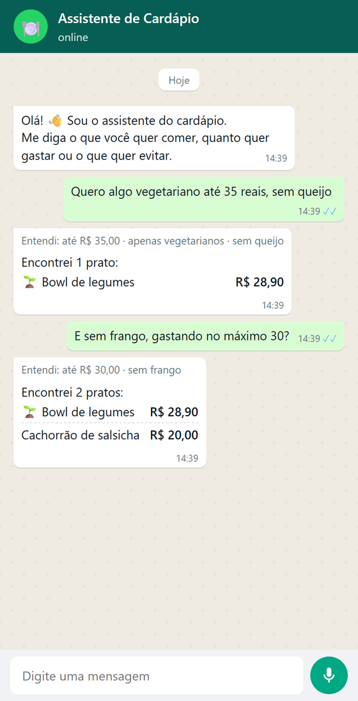
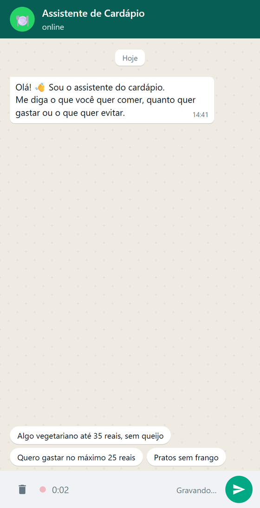
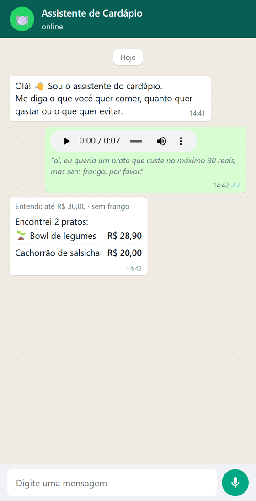
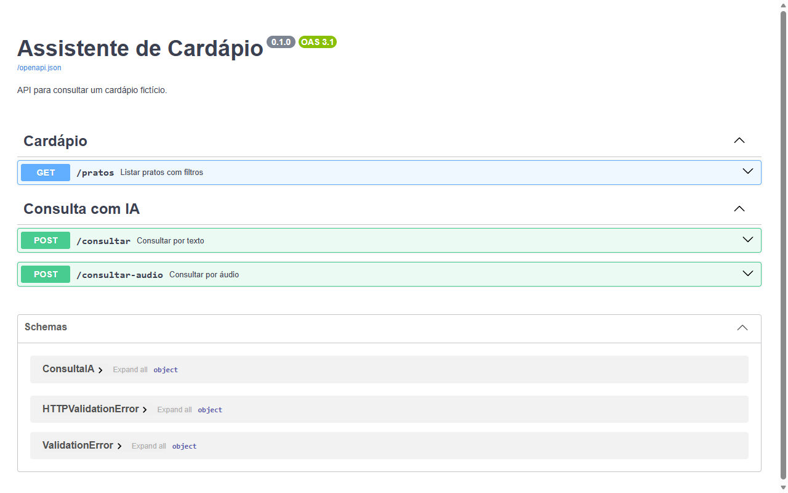
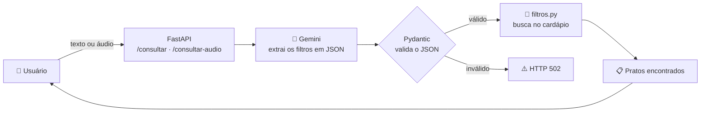

<h1 align="center">🍽️ Assistente de Cardápio com IA</h1>

<p align="center">
  Peça um prato do jeito que você falaria com uma pessoa, <b>por texto ou por áudio</b>.<br>
  A IA entende o pedido, e o Python encontra os pratos no cardápio.
</p>

<p align="center">
  
  
  
  
  
</p>

<p align="center">
  
</p>

> **Exemplo:** “Quero algo vegetariano até 35 reais, sem queijo.”
> → a IA extrai `{ preco_maximo: 35, apenas_vegetarianos: true, ingrediente_excluido: "queijo" }`
> → o Python devolve o **Bowl de legumes (R$ 28,90)**.

Projeto pessoal desenvolvido para estudar engenharia de software e
integração de modelos de linguagem.

---

## 📸 Demonstração

### Chat por texto

A interface de chat (rota `/chat`) mostra o que a IA entendeu antes de
listar os pratos encontrados. Ela acompanha o tema claro ou escuro do sistema.

<table>
  <tr>
    <td align="center"></td>
    <td align="center"></td>
  </tr>
  <tr>
    <td align="center"><sub>Tema claro</sub></td>
    <td align="center"><sub>Tema escuro</sub></td>
  </tr>
</table>

### Pedido por áudio 🎙️

Clique no microfone, fale o pedido e envie. O Gemini **transcreve e
interpreta o áudio numa única chamada**, e a transcrição aparece logo
abaixo do áudio.

<table>
  <tr>
    <td align="center"></td>
    <td align="center"></td>
  </tr>
  <tr>
    <td align="center"><sub>Gravando</sub></td>
    <td align="center"><sub>Transcrição e resultado</sub></td>
  </tr>
</table>

### Documentação interativa da API

O FastAPI gera a documentação em `/docs`, e dá para testar todas as
rotas pelo navegador.

<p align="center">
  
</p>

### Vídeo

Vídeo do fluxo de consulta, com a interpretação dos filtros, o resultado
da busca e as verificações do projeto:

https://github.com/user-attachments/assets/5daa361d-08a9-4f0f-9101-36f812e1763d

---

## ✨ Funcionalidades

- 💬 **Consulta em linguagem natural** por texto (`POST /consultar`).
- 🎙️ **Consulta por áudio** (`POST /consultar-audio`), com transcrição.
- 📱 **Chat web** em estilo mensageiro, com tema claro e escuro.
- 🔎 **Filtros determinísticos**: preço máximo, apenas vegetarianos e
  ingrediente a evitar (sem diferenciar maiúsculas).
- 🛡️ **Validação com Pydantic** de tudo o que a IA devolve.
- 🧪 **18 testes automatizados**, com a IA simulada (não gastam cota).
- 📊 **Script de avaliação** da interpretação com chamadas reais.
- ⌨️ Consulta **pelo terminal**, sem IA.

## 🧠 Como funciona

A IA **só interpreta** o pedido. Quem busca os pratos é código Python
comum, previsível e testável. Assim a IA não tem como "inventar" um
prato que não existe no cardápio.



Exemplo de resposta real de `POST /consultar-audio`:

```json
{
  "transcricao": "oi, eu queria um prato que custe no máximo 30 reais, mas sem frango, por favor.",
  "filtros": {
    "preco_maximo": 30.0,
    "apenas_vegetarianos": false,
    "ingrediente_excluido": "frango"
  },
  "quantidade": 2,
  "pratos": [
    { "id": 1, "nome": "Bowl de legumes", "preco": 28.9, "vegetariano": true },
    { "id": 5, "nome": "Cachorrão de salsicha", "preco": 20.0, "vegetariano": false }
  ]
}
```

<sub>Lista de ingredientes omitida para encurtar o exemplo.</sub>

### Tratamento de erros

| Situação | Status |
|---|---|
| Pergunta em branco, áudio vazio ou áudio sem fala | `422` |
| Formato de áudio não suportado | `415` |
| Áudio maior que 5 MB | `413` |
| Gemini fora do ar ou com limite de requisições atingido | `503` |
| Gemini devolveu resposta vazia ou JSON inválido | `502` |
| `GEMINI_API_KEY` não configurada | `500` |

## 🛠️ Tecnologias

| Tecnologia | Uso |
|---|---|
| **Python 3.12+** | Lógica da aplicação |
| **FastAPI** + **Uvicorn** | API HTTP e documentação interativa |
| **Google Gemini 3.1 Flash-Lite** | Interpretação de texto e áudio |
| **Pydantic** | Esquema e validação dos filtros |
| **unittest** + **unittest.mock** | Testes com a IA simulada |
| **HTML, CSS e JavaScript** | Chat web, sem frameworks nem dependências |

## 🚀 Como executar

Os comandos abaixo são para o Windows PowerShell.

**1. Criar o ambiente virtual e instalar as dependências**

```powershell
python -m venv .venv
.\.venv\Scripts\python.exe -m pip install -r requirements.txt
```

**2. Configurar a chave do Gemini**

Copie `.env.example` para `.env` e preencha `GEMINI_API_KEY` com sua
chave do [Google AI Studio](https://aistudio.google.com/apikey).
Opcionalmente, troque o modelo com `GEMINI_MODEL`.

**3. Iniciar a API**

```powershell
.\.venv\Scripts\python.exe -m uvicorn api:app --reload
```

| Endereço | O que é |
|---|---|
| http://127.0.0.1:8000/chat | 💬 Chat por texto e áudio |
| http://127.0.0.1:8000/docs | 📖 Documentação interativa |
| http://127.0.0.1:8000/pratos?preco_maximo=30 | 🔎 Busca direta, sem IA |

Para encerrar o servidor, pressione `Ctrl+C`.

> Para gravar áudio, use Chrome ou Edge e permita o acesso ao microfone.
> O navegador converte a gravação para WAV antes de enviar.

### Exemplos de requisição

```powershell
# Texto
curl.exe -X POST http://127.0.0.1:8000/consultar `
  -H "Content-Type: application/json" `
  -d '{\"pergunta\": \"Quero algo vegetariano até 35 reais, sem queijo\"}'

# Áudio (WAV, MP3, OGG, AAC, AIFF ou FLAC, até 5 MB)
curl.exe -X POST http://127.0.0.1:8000/consultar-audio `
  -H "Content-Type: audio/wav" --data-binary "@pedido.wav"
```

### Consulta pelo terminal (sem IA)

```powershell
.\.venv\Scripts\python.exe main.py
```

## 🧪 Testes

```powershell
.\.venv\Scripts\python.exe -m unittest -v
```

Os testes simulam o Gemini com `unittest.mock`, então rodam em
milissegundos e não consomem cota. Eles cobrem os filtros, as rotas de
texto e áudio e todos os caminhos de erro da tabela acima.

## 📊 Avaliação da interpretação com IA

Uma avaliação inicial com cinco perguntas e filtros esperados definidos
previamente:

| Modelo | Data | Filtros corretos | Erros de execução |
|---|---|---|---|
| `gemini-3.1-flash-lite` | 06/11/2026 | **5/5** | 0 |

Os casos incluem preço máximo, preferência vegetariana, exclusão de
ingrediente e consultas sem limite de preço. É uma única execução sobre
um conjunto pequeno, então não garante o mesmo desempenho em outras
perguntas.

```powershell
.\.venv\Scripts\python.exe avaliar_ia.py
```

> A avaliação faz cinco chamadas reais à API e consome sua cota.

## 📁 Organização

```
ia-consultor/
├── api.py              # Rotas HTTP e tratamento de erros
├── interpretador.py    # Integração com o Gemini (texto e áudio)
├── filtros.py          # Regras de busca (preço, vegetariano, ingrediente)
├── config.py           # Leitura e validação do .env
├── dados.py            # Cardápio fictício
├── static/
│   └── chat.html       # Chat web (texto e áudio)
├── main.py             # Consulta pelo terminal, sem IA
├── avaliar_ia.py       # Avaliação com chamadas reais ao Gemini
├── experimentar_ia.py  # Testa uma pergunta pelo terminal
├── listar_modelos.py   # Lista os modelos disponíveis na sua conta
├── test_api.py         # Testes das rotas (IA simulada)
├── test_filtros.py     # Testes das regras de busca
└── docs/img/           # Imagens deste README
```

## ⚠️ Limitações

- A IA pode interpretar perguntas incorretamente. A validação garante o
  **formato** da resposta, não que ela esteja **certa**.
- Só exclui um ingrediente por consulta.
- Não tem um filtro específico para pratos veganos.
- O filtro de ingredientes usa apenas os nomes cadastrados. Não verifica
  alergênicos nem contaminação cruzada.
- Depende da disponibilidade e das cotas da API do Gemini.
